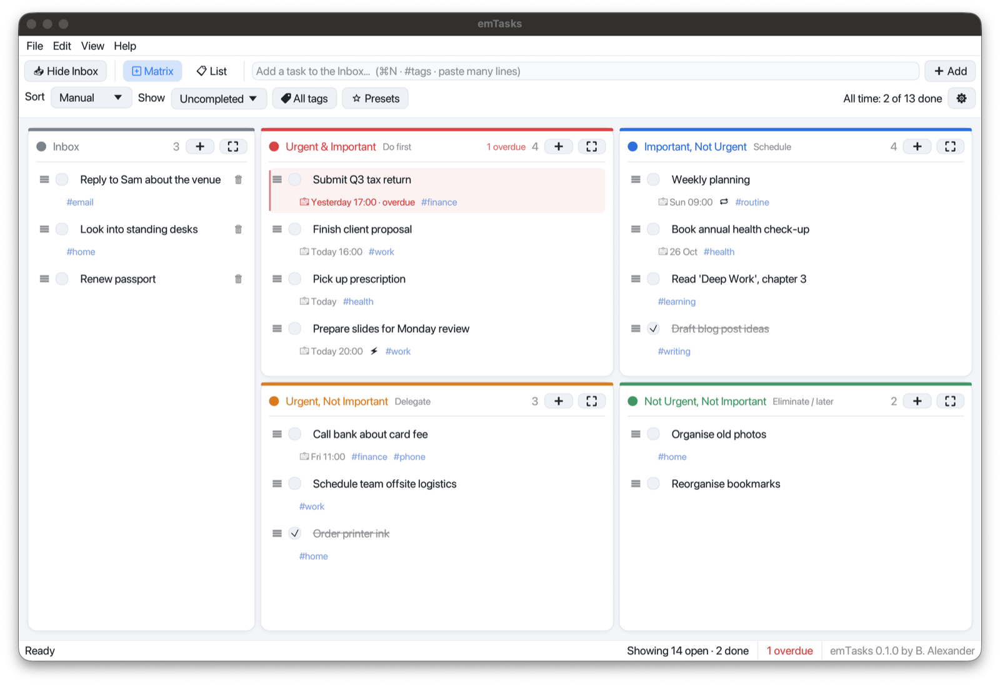
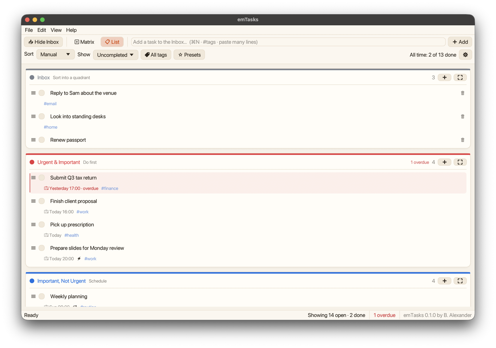
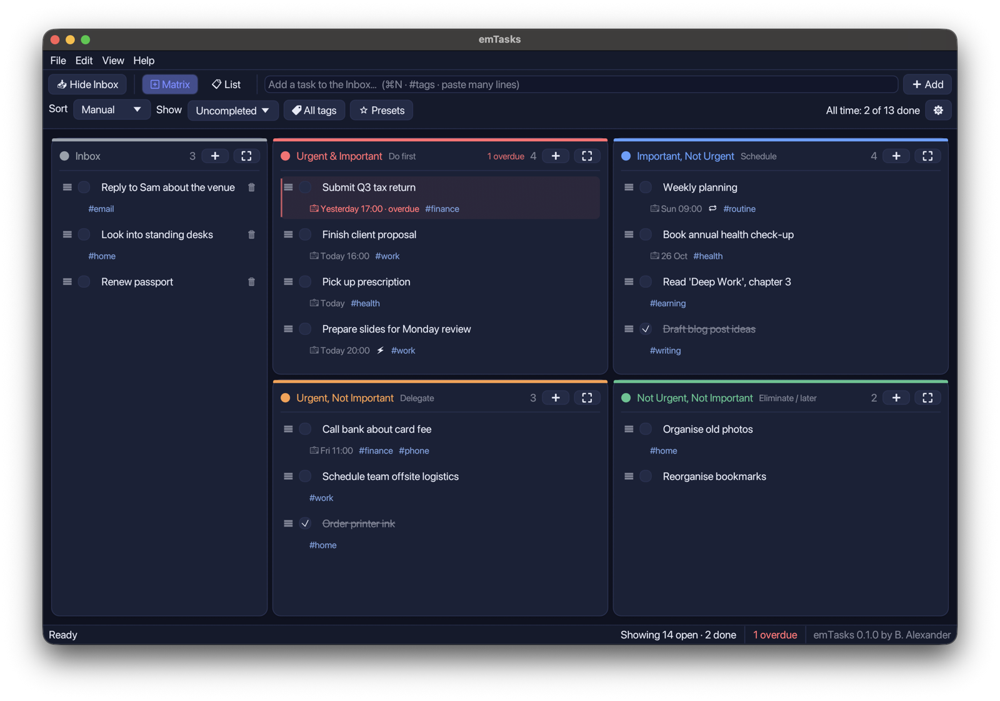

# emTasks

**A quiet to-do app for Mac that sorts your tasks by what's urgent and what's important.**



emTasks (*em* for **E**isenhower **M**atrix) is built on the **Eisenhower matrix**. Every task goes into one of four boxes, so it's obvious what to do now, what to plan, what to hand off and what to drop:

|  | **Urgent** | **Not urgent** |
| --- | --- | --- |
| **Important** | 🔴 **Do first** | 🔵 **Schedule** |
| **Not important** | 🟠 **Delegate** | 🟢 **Eliminate / later** |

New tasks wait in the **Inbox** until you drag them into a box.

- **Quiet.** No notifications, pop-ups or reminders. Overdue tasks are simply marked in red.
- **Smart, silently.** A task moves to Urgent by itself as its deadline gets close (marked ⚡).
- **Private.** It works offline, with no account and no network access. Your tasks live in a folder on your Mac.
- **Hard to lose data.** It autosaves, backs up every day, lets you undo your last 100 changes, and opens a recovery screen if anything goes wrong.

**Version 0.1.0** · [What's new](CHANGELOG.md) · macOS 11 or later on Apple Silicon · [MIT licensed](LICENSE)

---

## Install

1. Download `emTasks-0.1.0.zip` from the [latest release](https://github.com/binu-alexander/emtasks/releases/latest), unzip it, and open `emTasks-0.1.0.dmg`.
2. Drag **emTasks** onto **Applications**.
3. Open emTasks from Applications.

**The first time, macOS says "Apple could not verify emTasks".** That's because emTasks isn't notarized by Apple yet ([why](#known-limitations)). To allow it, once:

1. Click **Done** on the warning.
2. Open **System Settings → Privacy & Security**, scroll down, and click **Open Anyway** next to emTasks.
3. Confirm with your password or Touch ID.

<details>
<summary>Check your download wasn't altered (recommended when someone sends you the app)</summary>

Each release comes with a fingerprint file, `emTasks-<version>.zip.sha256`. In Terminal, run:

```sh
shasum -a 256 emTasks-0.1.0.zip
```

The code it prints must exactly match the one in the `.sha256` file. Ideally, get the fingerprint through a different channel than the zip.
</details>

**Updating:** quit emTasks (⌘Q), drag the new version onto Applications, and choose **Replace**. Your tasks are stored outside the app, so they're kept. The version you're running is shown in the bottom-right corner of the window.


---

## Using emTasks

### Add tasks

- Type in the box at the top and press **Enter**. The task goes to the **Inbox**.
- To add straight into a box, click its **➕**. The field stays open so you can add several in a row; **Esc** closes it.
- Add tags as you type: `Call the bank #finance #phone`
- **Paste several lines** to create one task per line. Bullets such as `-`, `*` and `•` are removed.

### Organize

- **Drag** a task by grabbing it anywhere and drop it into another box. With sorting set to Manual, drop it onto another task to place it there. A plain click only selects a task; it never moves it.
- **Triage the Inbox:** 🗑 or **Delete (⌫)** removes an Inbox task at once, and ⌘Z brings it back. Tasks in the other boxes ask before deleting.
- **⛶** maximizes a box; **Esc** goes back. **⌘L** switches between the **Matrix** and a **List** of all boxes.
- **📥 Hide Inbox** (or ⌘I) gives the four boxes the full width. While it's hidden, the button shows how many tasks are waiting.
- **Two counters:**
  - **Top right, all-time progress:** for example **All time: 9 of 22 done**. It counts every task in the four boxes, including completed ones that are hidden. Inbox tasks count once you sort them.
  - **Status bar, what's on screen now:** for example **Showing 13 open · 2 done**. It counts the tasks in the sections you can see, after filters. Completed tasks are counted only while they're still shown (see *Completed tasks* below). Overdue tasks get a separate red count.



### Task details

Click a task to open the details panel on the right, where you can set:

- **Due date and time**, or **All day**. Type `YYYY-MM-DD` and `HH:MM` (24-hour), or use 📅 and the **Today / Tomorrow / Next week** buttons. A date without a time means 09:00, unless the task is all-day.
- **Repeat** every N days, weeks, months or years. Completing a repeating task creates the next one.
- **Tags:** type them separated by commas, or click any tag you've already used to add or remove it.
- **Notes**, and a **linked task**: this task moves to Urgent when the linked one is done.
- The created and completed dates are recorded for you.

### Deadlines and overdue tasks

- When a task is due within **24 hours**, emTasks moves it to Urgent and marks it ⚡. Important tasks go to *Do first*; the rest go to *Delegate*. You can change the 24 hours, or turn this off, in **Settings** (⌘,).
- **Overdue** tasks get a red tint and bar, a red date followed by "· overdue", and a count in their box's header and in the status bar. There are never any notifications.
- These checks run while emTasks is open. Anything that came due while it was closed is sorted the next time you open it.

### Sort, filter and find

- **Sort** by Manual order, Title or Due date. Completed tasks always sink to the bottom.
- **Show** *Uncompleted* (the usual view), *All tasks* or *Completed*.
- **Completed tasks in the Uncompleted view** can **hide right away** (the default), **show for 3 days** or **show for 1 week**. Choose this at the bottom of the **Show** menu or in Settings.
- **🏷 Tags** shows tasks that have any of the tags you pick. **⭐ Presets** saves a sort and filter combination so you can return to it in one click.
- **Missing tasks?** If a filter is hiding any, a yellow bar says how many, with a **Show all tasks** button.

### Themes

Pick one under **View → Theme** or in **Settings**. Your choice is remembered.

| **Classic** | **Daylight** | **Paper** | **Midnight** | **Graphite** |
| --- | --- | --- | --- | --- |
| The original look | Light, blue accents | Light, warm cream | Dark, deep navy | Dark, charcoal and teal |



### Keyboard shortcuts

| Keys | Action |
| --- | --- |
| ⌘N | New task (into the maximized box, if one is open) |
| ↑ / ↓ | Select the previous / next task |
| ⌘↩ | Complete or reopen the selected task |
| ⌫ or ⌘⌫ | Delete the selected task (instantly in the Inbox, asks first elsewhere) |
| ⌘1 – ⌘4 | Move to Do first / Schedule / Delegate / Eliminate |
| ⌘0 | Move to the Inbox |
| ⌘Z / ⇧⌘Z | Undo / redo |
| ⌘L | Switch between Matrix and List |
| ⌘I | Show or hide the Inbox |
| ⌘, | Settings |
| Esc | Close the add box, restore a maximized box, or close the details panel |

The same list is in the app under **Help → Keyboard shortcuts**.

---

## Your data and backups

emTasks saves about a second after every change, and again when you quit. Each save goes to a temporary file first and then replaces the old one, so a crash or power cut can't leave a half-written file.

| What | Where | When | Kept |
| --- | --- | --- | --- |
| **Your tasks** | `~/Library/Application Support/emTasks/emtasks-data.ron` | Saved continuously | — |
| **Full backups** (everything, including linked tasks) | `…/emTasks/backups/` | Every launch, and **File → Back up now** | Newest 20 |
| **Daily CSV backup** (opens in Numbers or Excel) | `~/Documents/emTasks/` | First run each day, refreshed when you quit | Newest 30 days |
| **CSV export** | `~/Downloads/` | **File → Export tasks to CSV** | Until you delete it |

- **To find them:** **File → Show data in Finder** opens the data folder, and **Settings → Show** opens the daily CSV folder. `Library` is hidden in Finder, so press **⇧⌘G** and paste the path.
- **If the data file is ever damaged,** emTasks doesn't overwrite it. It opens a recovery screen where you can restore a full backup or start fresh, and keeps the damaged file either way.
- **To restore from a CSV,** use **File → Import tasks from CSV…** or drop the file onto the window. Import only adds tasks, never changes or removes them, and skips tasks you already have, so importing the same file twice is safe. ⌘Z undoes it. CSV files don't include linked-task connections.
- **One copy at a time.** If emTasks is already open, a second copy says so and doesn't touch your tasks.
- **Moving to a new Mac:** copy the `~/Library/Application Support/emTasks` folder to the same place on the new Mac.

<details>
<summary>CSV format</summary>

Columns: `title, quadrant, completed, due_date, due_time, all_day, repeat, repeat_every, tags, notes, created, completed_at`.

Export includes every task, whatever filter is on. For import, only `title` is required, and a plain list with one task per line also works. Rows with problems, such as a date that isn't `YYYY-MM-DD`, are still imported and listed in a short report.
</details>

## Privacy and security

- **No network access.** emTasks contains no networking code. The only copy that can leave your Mac is the daily CSV in Documents, and only if your Documents folder syncs with iCloud. Turn the daily backup off in Settings if you don't want that.
- **Your data** is in your private Library folder, which other users on the Mac can't open. emTasks doesn't encrypt it; turn on FileVault to encrypt your whole disk.
- **Hardened app.** It's signed with macOS's hardened runtime, which stops other programs injecting code into it.
- **Safe CSV.** Exported cells that start with `=`, `+`, `-` or `@` are saved as plain text, so a spreadsheet won't run them as formulas; import converts them back. Files over 20 MB are refused.
- **Checked dependencies.** Third-party libraries are audited against the RustSec advisory database on every change.

## Known limitations

- **Apple Silicon only.** emTasks doesn't run on Intel Macs yet.
- **Not notarized.** Notarization needs a paid Apple Developer account, so for now everyone sees the one-time "Open Anyway" step above. The build script is ready to notarize once an account is set up.
- **No sync between Macs,** and no automatic updates.
- **No reminders, by design.** emTasks never interrupts you.

## More

- [CHANGELOG.md](CHANGELOG.md): what changed in each version
- [SPEC.MD](SPEC.MD): the product spec, exact rules and design decisions
- [CONTRIBUTING.md](CONTRIBUTING.md): building from source, tests, project layout and releases
- [LICENSE](LICENSE): MIT
